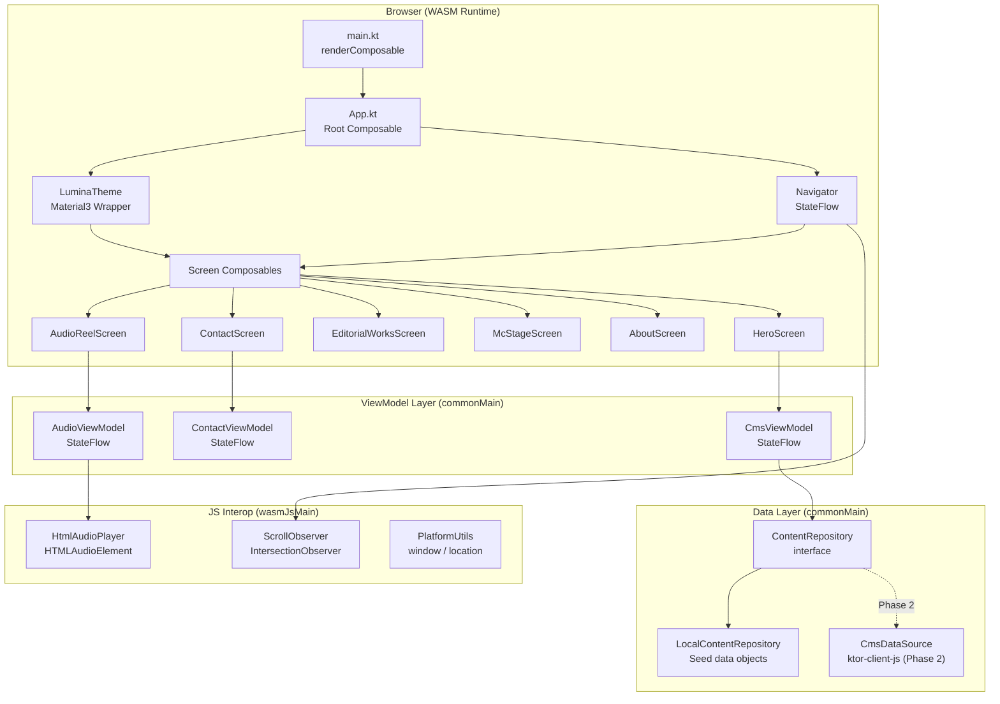

# Naulia Zahra — Portfolio Platform: Comprehensive Development Plan

> **Tech Stack:** Kotlin Multiplatform (KMP) · Compose for Web (Compose HTML / Compose Multiplatform WASM) · Kotlin/JS  
> **Target Platform:** Web-only (no Android / iOS targets)  
> **Design System:** Curated Lumina — Warm Cream × Coral `#ff8e72` × Outfit typeface

---

## 0. Tech Stack Decision Rationale

| Concern | Choice | Reason |
|---|---|---|
| Language | Kotlin | Single language across all layers |
| UI Framework | **Compose Multiplatform for Web (WASM target)** | Declarative, fully Kotlin, Compose paradigm |
| Shared Logic | **Kotlin Multiplatform (commonMain)** | Business logic, state management, models shared |
| Web target | `wasmJs` (WASM) with `browser` target | Best performance & full Compose runtime |
| CMS / Content | Local `data` module (Kotlin objects/serialized JSON) → Phase 2: headless CMS API | Simple, type-safe, no backend needed in Phase 1 |
| Audio | HTML5 `<audio>` via `kotlinx-browser` interop | Native browser audio API, no extra lib |
| Form Backend | Formspree / Resend webhook (REST) via `ktor-client-js` | Lightweight, no server required |
| Styling | Compose theming system + CSS custom properties injected via `kotlinx-browser` | Full Compose theming, Outfit font via Google Fonts |
| Build | Gradle (Kotlin DSL) + `wasmJsBrowserDistribution` | Standard KMP toolchain |
| Deployment | GitHub Pages / Netlify / Vercel (static WASM bundle) | Zero-server, CDN-served |

---

## 1. Project Structure

```
naulia-personal-portofolio/
├── build.gradle.kts                    # Root build config
├── settings.gradle.kts
├── gradle/
│   └── libs.versions.toml             # Version catalog
│
├── composeApp/                         # Main KMP module
│   ├── build.gradle.kts
│   └── src/
│       ├── commonMain/kotlin/id/naulia/portfolio/
│       │   ├── App.kt                  # Root @Composable entry point
│       │   ├── navigation/
│       │   │   ├── NavSection.kt       # Sealed class: Home, Audio, Books, MC, About, Contact
│       │   │   └── Navigator.kt        # State-based scroll navigator
│       │   ├── data/
│       │   │   ├── model/
│       │   │   │   ├── AudioTrack.kt   # id, title, category, durationSec, assetUrl, tags
│       │   │   │   ├── Book.kt         # id, title, publisher, ageRange, role, coverAsset, year
│       │   │   │   ├── McEvent.kt      # id, eventName, date, venue, attendees, photoAsset, tags
│       │   │   │   └── ContactForm.kt  # name, contact, services (Set<Service>), scope, message
│       │   │   ├── repository/
│       │   │   │   ├── ContentRepository.kt    # Interface
│       │   │   │   └── LocalContentRepository.kt # Hardcoded seed data (Phase 1 CMS)
│       │   │   └── cms/
│       │   │       └── CmsDataSource.kt         # Phase 2: REST/JSON remote
│       │   ├── ui/
│       │   │   ├── theme/
│       │   │   │   ├── LuminaTheme.kt  # MaterialTheme wrapper + color tokens
│       │   │   │   ├── LuminaColors.kt # Warm cream, coral, mint, lavender tokens
│       │   │   │   └── LuminaTypography.kt  # Outfit font scales
│       │   │   ├── components/         # Shared atomic components
│       │   │   │   ├── SectionHeader.kt
│       │   │   │   ├── CredentialChip.kt
│       │   │   │   ├── ServicePill.kt
│       │   │   │   └── AnimatedEqualizer.kt
│       │   │   └── screens/            # One composable per section
│       │   │       ├── HeroScreen.kt
│       │   │       ├── AudioReelScreen.kt
│       │   │       ├── EditorialWorksScreen.kt
│       │   │       ├── McStageScreen.kt
│       │   │       ├── AboutScreen.kt
│       │   │       └── ContactScreen.kt
│       │   └── viewmodel/
│       │       ├── AudioViewModel.kt   # playback state, activeTrackId, progress
│       │       ├── ContactViewModel.kt # form state, submission, validation
│       │       └── CmsViewModel.kt     # content loading state (Phase 2)
│       │
│       └── wasmJsMain/kotlin/id/naulia/portfolio/
│           ├── main.kt                 # wasmJs entry: renderComposable { App() }
│           ├── audio/
│           │   └── HtmlAudioPlayer.kt  # HTMLAudioElement interop (actual)
│           ├── navigation/
│           │   └── ScrollObserver.kt   # IntersectionObserver JS interop
│           └── platform/
│               └── PlatformUtils.kt    # window.open, WhatsApp deep link, etc.
│
├── cms-admin/                          # Optional: simple local CMS admin (Phase 2)
│   └── src/wasmJsMain/kotlin/...      # Separate entry for /admin route
│
├── assets/
│   ├── audio/                         # .mp3 / .ogg demo reels
│   ├── images/                        # WebP book covers, event photos, portrait
│   └── fonts/                         # Outfit variable font (self-hosted fallback)
│
├── PRD.md
├── PLAN.md                            # ← this file
└── PROMPTS.md                         # ← step-by-step prompts
```

---

## 2. Architecture Overview



---

## 3. Data Models (commonMain)

```kotlin
// AudioTrack.kt
data class AudioTrack(
    val id: String,
    val title: String,
    val category: AudioCategory,  // ALL, STORY, SCIENCE, CHARACTER_VO
    val durationSec: Int,
    val assetUrl: String,         // "audio/track_01.mp3"
    val tags: List<String>
)

// Book.kt
data class Book(
    val id: String,
    val title: String,
    val publisher: Publisher,     // GRAMEDIA, BIP, MIZAN, ERLANGGA
    val ageRange: AgeRange,       // AGE_3_6, AGE_4_8, AGE_7_12
    val roles: List<EditorRole>,  // DEVELOPMENTAL_EDITOR, STEM_FACT_CHECKER, etc.
    val coverAsset: String,       // "images/covers/book_01.webp"
    val year: Int
)

// McEvent.kt
data class McEvent(
    val id: String,
    val eventName: String,
    val date: String,             // "2024-03"
    val venue: String,
    val estimatedAttendees: Int,
    val photoAsset: String,
    val tags: List<String>
)

// ContactForm.kt
data class ContactForm(
    val name: String,
    val contact: String,          // Email or WhatsApp
    val services: Set<ServiceType>,
    val scope: String,
    val message: String
)
```

---

## 4. State Management

| ViewModel | State Class | Key Fields |
|---|---|---|
| `AudioViewModel` | `AudioUiState` | `activeTrackId`, `isPlaying`, `progressSec`, `durationSec`, `selectedCategory` |
| `ContactViewModel` | `FormState` | `form: ContactForm`, `isLoading`, `isSuccess`, `errorMessage`, `validationErrors` |
| `CmsViewModel` | `ContentState` | `tracks: List<AudioTrack>`, `books: List<Book>`, `events: List<McEvent>`, `isLoading` |

All ViewModels use `kotlinx.coroutines` + `StateFlow`. No Android ViewModel dependency — plain Kotlin classes with `CoroutineScope`.

---

## 5. Navigation Model

```kotlin
sealed class NavSection(val id: String, val labelId: String) {
    object Home     : NavSection("home",             "nav_home")
    object Audio    : NavSection("featured-audiobook","nav_audio")
    object Books    : NavSection("editorial-works",  "nav_books")
    object Stage    : NavSection("mc-stage",         "nav_mc")
    object About    : NavSection("about",            "nav_about")
    object Contact  : NavSection("contact",          "nav_contact")
}
```

Navigation is **scroll-based, not route-based** — no multipage routing needed. `IntersectionObserver` (JS interop) updates `Navigator.activeSection: StateFlow<NavSection>` as the user scrolls.

---

## 6. CMS Strategy (Simple Admin UI — Phase 2)

The "CMS" for Phase 1 is **Kotlin data objects** in `LocalContentRepository.kt`. This gives:
- Zero backend
- Type-safe content editing directly in IDE
- Fast build & deploy

**Phase 2 CMS Admin:**
- Separate Compose for Web entry point at `/admin`
- Password-protected (simple localStorage token)
- Writes JSON to a backend (Supabase / GitHub API)
- Main site reads JSON from public URL via `ktor-client-js`

---

## 7. Audio Playback Architecture (wasmJsMain)

```kotlin
// HtmlAudioPlayer.kt — JS interop
actual class AudioPlayer {
    private var audioElement: HTMLAudioElement? = null

    actual fun load(url: String) {
        audioElement = document.createElement("audio") as HTMLAudioElement
        audioElement!!.src = url
    }
    actual fun play()  { audioElement?.play() }
    actual fun pause() { audioElement?.pause() }
    actual fun seekTo(seconds: Double) { audioElement?.currentTime = seconds }
    actual fun getCurrentTime(): Double = audioElement?.currentTime ?: 0.0
    actual fun getDuration(): Double = audioElement?.duration ?: 0.0
    actual fun setOnTimeUpdate(callback: (Double) -> Unit) {
        audioElement?.ontimeupdate = { callback(audioElement!!.currentTime) }
    }
}
```

`AudioViewModel` holds a single `AudioPlayer` instance and enforces **single-active-player** constraint — playing a new track automatically pauses the current.

---

## 8. Form Submission (Collaboration Request)

```
ContactViewModel.submit()
    → validateForm()
    → ktor-client POST to Formspree endpoint
    → on success: FormState.isSuccess = true  (show confirmation UI)
    → on failure: FormState.errorMessage = "..."
```

WhatsApp direct-link: `window.open("https://wa.me/62xxx?text=...")` via `PlatformUtils.kt`.

---

## 9. Development Phases

### Phase 1 — Foundation & UI Shell *(Sprint 1–2)*
- [ ] KMP project scaffold (Gradle, `wasmJs` target, Compose Multiplatform)
- [ ] `LuminaTheme` color + typography tokens
- [ ] `NavSection` sealed class + `Navigator` state
- [ ] All 6 screen composables — static/hardcoded content
- [ ] Sticky top nav + active section highlight
- [ ] Smooth scroll via JS interop
- [ ] `HeroScreen` — portrait, credential chips, CTA buttons

### Phase 2 — Interactive Features *(Sprint 3–4)*
- [ ] `AudioReelScreen` — category filter tabs, track list
- [ ] `HtmlAudioPlayer` JS interop + `AudioViewModel`
- [ ] Animated equalizer bars (`AnimatedEqualizer.kt`)
- [ ] Interactive scrubber with live timestamps
- [ ] `EditorialWorksScreen` — book cover grid, age/role badges
- [ ] `McStageScreen` — metrics grid, event photo gallery
- [ ] `AboutScreen` — philosophy quote + capability pills

### Phase 3 — Form & CMS *(Sprint 5)*
- [ ] `ContactScreen` — multi-select service pills, form inputs
- [ ] `ContactViewModel` + validation logic
- [ ] Formspree/Resend integration via `ktor-client-js`
- [ ] WhatsApp deeplink from `PlatformUtils`
- [ ] `LocalContentRepository` with full seed content
- [ ] `CmsViewModel` wired to all screens

### Phase 4 — Polish & Deploy *(Sprint 6)*
- [ ] `IntersectionObserver` scroll-spy → active nav highlight
- [ ] `prefers-reduced-motion` support
- [ ] Keyboard navigation & focus rings (a11y)
- [ ] WebP/SVG asset optimization
- [ ] `wasmJsBrowserDistribution` → Netlify / GitHub Pages deploy
- [ ] Bilingual strings (Bahasa Indonesia primary, English toggle)

### Phase 5 — CMS Admin UI *(Future)*
- [ ] Separate `/admin` Compose entry
- [ ] JSON CRUD for tracks, books, events
- [ ] Remote data fetch in main site

---

## 10. Key Dependencies (libs.versions.toml)

```toml
[versions]
kotlin                  = "2.1.0"
compose-multiplatform   = "1.7.3"
ktor                    = "3.0.3"
kotlinx-coroutines      = "1.9.0"
kotlinx-serialization   = "1.7.3"

[libraries]
compose-runtime         = { module = "org.jetbrains.compose.runtime:runtime",     version.ref = "compose-multiplatform" }
compose-foundation      = { module = "org.jetbrains.compose.foundation:foundation",version.ref = "compose-multiplatform" }
compose-material3       = { module = "org.jetbrains.compose.material3:material3", version.ref = "compose-multiplatform" }
ktor-client-core        = { module = "io.ktor:ktor-client-core",                   version.ref = "ktor" }
ktor-client-js          = { module = "io.ktor:ktor-client-js",                     version.ref = "ktor" }
ktor-serialization-json = { module = "io.ktor:ktor-serialization-kotlinx-json",    version.ref = "ktor" }
kotlinx-coroutines-core = { module = "org.jetbrains.kotlinx:kotlinx-coroutines-core", version.ref = "kotlinx-coroutines" }
kotlinx-serialization   = { module = "org.jetbrains.kotlinx:kotlinx-serialization-json", version.ref = "kotlinx-serialization" }

[plugins]
kotlin-multiplatform    = { id = "org.jetbrains.kotlin.multiplatform",    version.ref = "kotlin" }
kotlin-serialization    = { id = "org.jetbrains.kotlin.plugin.serialization", version.ref = "kotlin" }
compose-multiplatform   = { id = "org.jetbrains.compose",                 version.ref = "compose-multiplatform" }
compose-compiler        = { id = "org.jetbrains.kotlin.plugin.compose",   version.ref = "kotlin" }
```

---

## 11. Deployment

| Step | Command / Action |
|---|---|
| Local dev server | `./gradlew :composeApp:wasmJsBrowserDevelopmentRun` |
| Production build | `./gradlew :composeApp:wasmJsBrowserDistribution` |
| Output dir | `composeApp/build/dist/wasmJs/productionExecutable/` |
| Deploy (Netlify) | Drag & drop output dir, or connect GitHub repo + set build command above |
| Deploy (GitHub Pages) | GitHub Actions workflow: build → `gh-pages` branch push |

---

## 12. Accessibility Checklist

- [ ] Contrast ratio ≥ 4.5:1 for all text (Lumina tokens pre-validated)
- [ ] All interactive elements have `Modifier.semantics { contentDescription = "..." }`
- [ ] `SemanticsProperties.Role` set on buttons, links, images
- [ ] Audio player: keyboard-controllable (Space = play/pause, Arrow = seek)
- [ ] `prefers-reduced-motion`: AnimatedEqualizer stops animation, transitions instant
- [ ] Focus rings visible on all focusable composables
